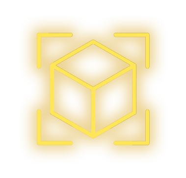

# umbral-ar-outsideview

<!doctype html>
<html lang="es">
<head>
  <meta charset="utf-8">
  <meta name="viewport" content="width=device-width, initial-scale=1.0">

  <title>A la cARta Demo</title>

  

  
</head>

<body>

  

    <!-- CAMBIA logo.png POR TU LOGO -->
  
    

    

@@ -249,30 +249,30 @@

      

        <!-- CAMBIA icono.png POR TU LOGO -->
      
        

      

      

        

          PRESIONA AQUÍ
        

        

          para ver el platillo en tu mesa
        

      

      

        ›
      

    </button>

  </model-viewer>

</body>
</html>
